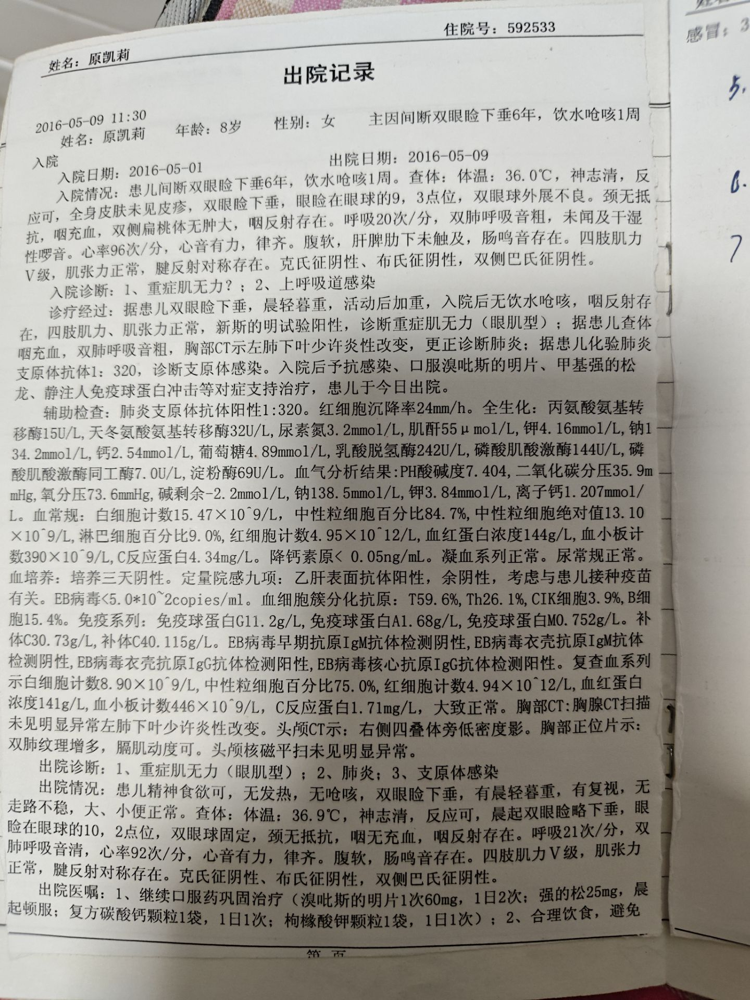
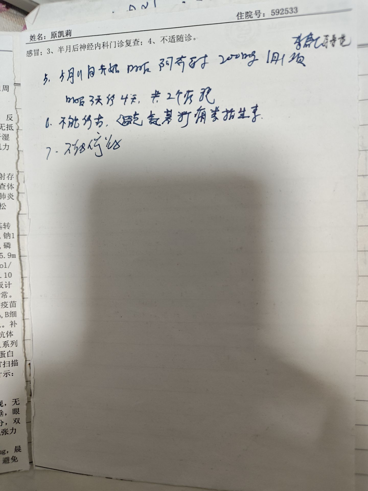

# 2016-05-09 出院记录

这是历史病历归档，不是当前诊疗方案。是否继续执行由主治医生决定。完整正文和化验数值以原图为准，此处不二次抄录。

这份资料回答的问题：2016 年 5 月这次住院的诊断、住院时间和出院医嘱印在哪一页。

## 单据信息

- 就诊人：原凯莉
- 性别、当时年龄：女，8 岁
- 住院号：592533
- 入院：2016-05-01
- 出院：2016-05-09
- 主诉：间断双眼睑下垂 6 年，饮水呛咳 1 周
- 入院诊断：1、重症肌无力？ 2、上呼吸道感染
- 出院诊断：1、重症肌无力（眼肌型） 2、肺炎 3、支原体感染

出院医嘱的印刷条目和同页手写补充，整理在 [[2016-05-出院医嘱]]。

## 原件

同一次单据上的手写补充：

## 待核实

- 医院名称未印在已拍到的页面上，地区仍写「未注明」。2026-10-14 病情自述写这次住院在山西省儿童医院，见 [[2026-10-14-病情自述]]。照片本身仍不能核对院名。2019-10-30 那份出院记录的信头才是山西省儿童医院妇幼保健院，不能倒推这次也是这家医院。见 [[2019-10-30-出院记录]]。
- 手写第 5–7 条未核录，见 [[2016-05-出院医嘱]]。
