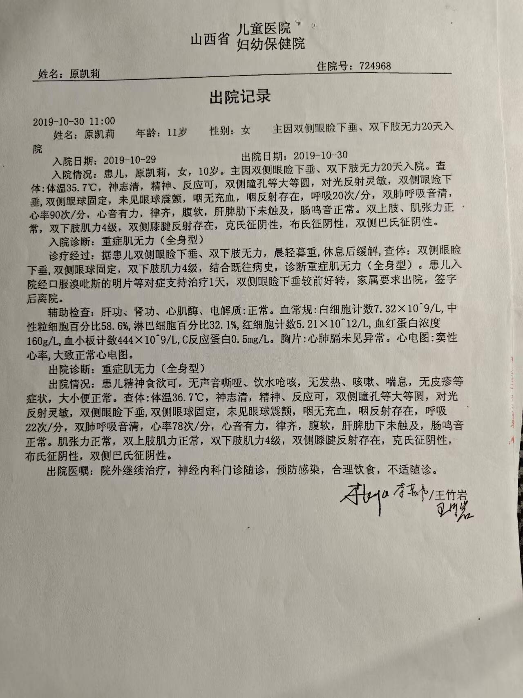
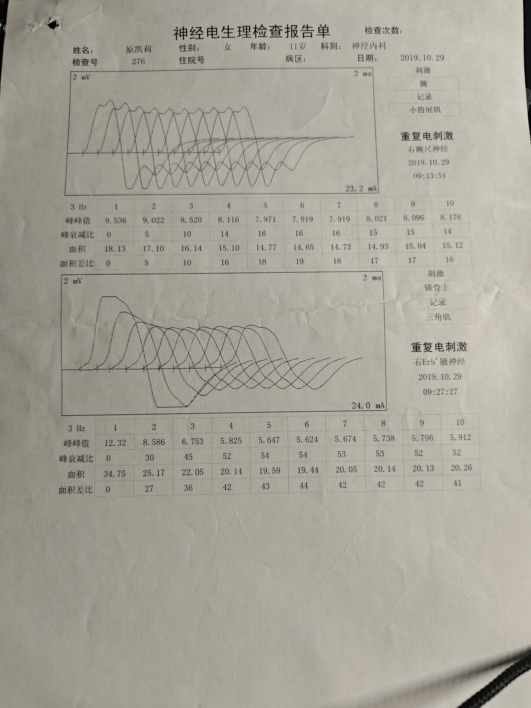
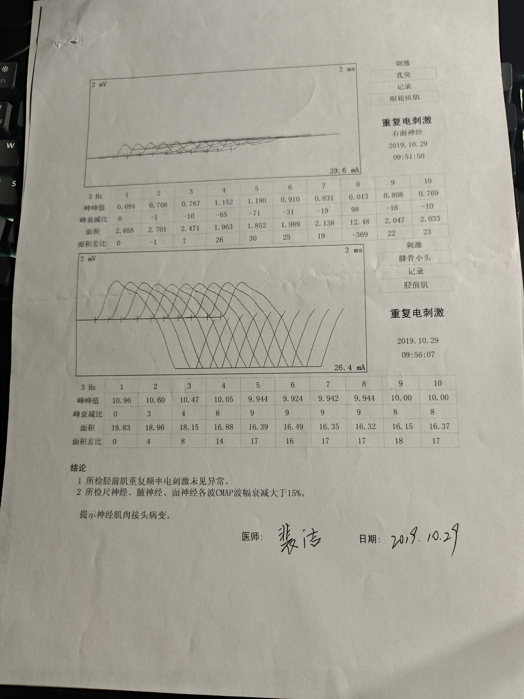

# 2019-10-30 出院记录

这是历史病历归档，不是当前诊疗方案。是否继续执行由主治医生决定。完整正文和化验数值以原图为准，此处不二次抄录。

这份资料回答的问题：2019 年 10 月这次短期住院的医院、诊断和出院医嘱印在哪一页，以及前一天的重复电刺激结论写了什么。

## 单据信息

- 信头：山西省儿童医院，下一行是妇幼保健院。页面没有印城市名，所以地区仍写「未注明」。
- 就诊人：原凯莉
- 住院号：724968
- 文书时间：2019-10-30 11:00
- 页眉年龄：11 岁。入院情况正文写「女，10 岁」。两处都按页面保留，不合成一个年龄。
- 性别：女
- 主因：双侧眼睑下垂、双下肢无力 20 天入院
- 入院：2019-10-29
- 出院：2019-10-30
- 入院诊断：重症肌无力（全身型）
- 出院诊断：重症肌无力（全身型）
- 诊疗经过里写到的治疗：口服溴吡斯的明片等对症支持治疗 1 天。没有写每片毫克，也没有写一天几次。并写双侧眼睑下垂较前好转，家属要求出院，签字后离院。
- 辅助检查的结论用语：肝功、肾功、心肌酶、电解质：正常。胸片：心肺膈未见异常。心电图：窦性心率，大致正常心电图。血常规的各项计数只留在原图上。
- 出院医嘱：院外继续治疗，神经内科门诊随诊，预防感染，合理饮食，不适随诊。没有点名药物，也没有剂量。
- 页末有手写签名，未逐字核对。

这次没有单独写医嘱笔记。页面上没有可以把剂量抄下来的处方。不据此改 [[当前用药]]。

## 同一次的重复电刺激

检查日期 2019-10-29。报告单标题是「神经电生理检查报告单」。这张报告上没有印医院名称。姓名、性别、年龄和日期与上面的出院记录对得上：原凯莉，女，11 岁，神经内科。检查号 276。住院号、病区、检查次数这几栏，图上没有填写。

两页都是 3 Hz 重复电刺激。各波峰峰值和面积见原图，这里不抄。

- 第 1 页：右腕尺神经，记录小指展肌，09:13:51。右 Erb' 腋神经，记录三角肌，09:27:27。
- 第 2 页：右面神经，记录眼轮匝肌，09:51:50。腓骨小头刺激，记录胫前肌，09:56:07。

结论按原件：

1. 所检胫前肌重复频率电刺激未见异常。
2. 所检尺神经、腋神经、面神经各波 CMAP 波幅衰减大于 15%。

提示神经肌肉接头病变。

医师栏有手写签名，日期写 2019.10.29。签名未逐字核对。

## 原件

## 待核实

- 页末签名未逐字核对。
- 这次住院的入院记录、处方、抗体报告、胸部影像不在库里。
- 2016-05-09 那次出院记录的照片仍然没有院名。不能用这张 2019 年的信头倒推 2016 年也是这家医院。见 [[2016-05-09-出院记录]]。
- [[2026-10-14-病情自述]] 写「肌电图确诊为全身型」。这份报告的结论是「提示神经肌肉接头病变」，没有那一句。自述原文不改。
