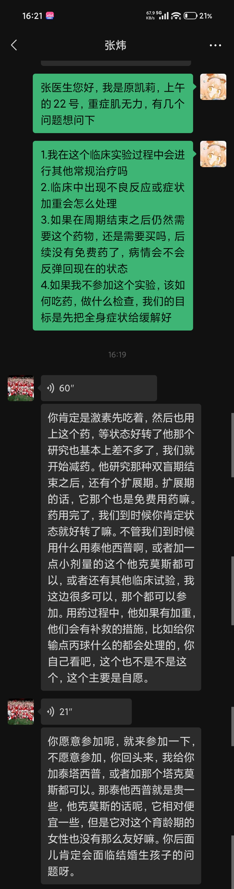
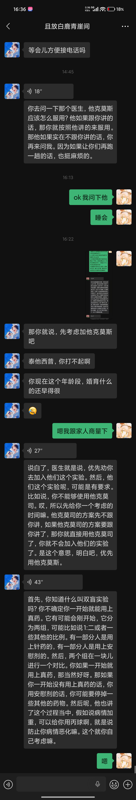

# 2026-10-26 张炜微信回复

这是 2026-10-26 门诊之后，微信屏幕上能看见的文字。不是处方，也不是当前用药。语音原声不在库里。长段文字像语音识别结果，药名有几种写法，不改成标准名。是否参加试验、是否换药，由主治医生书面决定。不据此修改 [[当前用药]]。

这份资料回答的问题：当天就诊人向张炜问了什么，屏幕上留下哪些回复；另一段对话里，对方又说了什么。

城市写太原，是因为同一天的号在 [[2026-10-26-山医大一院挂号]]。截图本身没有印医院名。就诊人自称「上午的 22 号」，挂号笔记里的就诊号是 22。

## 和张炜的对话

截图状态栏约 16:21。患者两段问题下面标着 16:19。手机文件名时间是 16:37。

患者发出的文字：

> 张医生您好，我是原凯莉，上午的 22 号，重症肌无力，有几个问题想问下
>
> 1.我在这个临床实验过程中会进行其他常规治疗吗
> 2.临床中出现不良反应或症状加重会怎么处理
> 3.如果在周期结束之后仍然需要这个药物，还是需要买吗，后续没有免费药了，病情会不会反弹回现在的状态
> 4.如果我不参加这个实验，该如何吃药，做什么检查，我们的目标是先把全身症状给缓解好

其后是一条 60 秒语音。紧接着一段文字。图上没有标明这段文字就是该语音的转写：

> 你肯定是激素先吃着，然后也用上这个药，等状态好转了他那个研究也基本上差不多了，我们就开始减药。他研究那种双盲期结束之后，还有个扩展期。扩展期的话，它那个也是免费用药嘛。药用完了，我们到时候你肯定状态就好转了嘛。不管我们到时候用什么用泰他西普啊，或者加一点小剂量的这个他克莫斯都可以，或者还有其他临床试验，我这边很多可以，那个都可以参加。用药过程中，他如果有加重，他们会有补救的措施，比如给你输点丙球什么的都会处理的，你自己看吧，这个也不是不是这个，这个主要是自愿。

再后面是一条 21 秒语音，然后又一段文字。同样没有标明它是不是该语音的转写：

> 你愿意参加呢，就来参加一下，不愿意参加，你回头来，我给你加泰塔西普，或者加那个塔克莫斯都可以。那泰他西普就是贵一些，他克莫斯的话呢，它相对便宜一些，但是它对这个育龄期的女性也没有那么友好嘛。你后边儿肯定会面临结婚生孩子的问题呀。

屏幕上的药名写法不一致：泰他西普、泰塔西普；他克莫斯、塔克莫斯。没有毫克，没有一天几次，没有试验名称。「激素先吃着」没有写药名和剂量。「丙球」按屏幕上的这两个字保留。患者写的是「临床实验」，这段回复里写的是「临床试验」。

## 另一段微信

对方昵称是「且放白鹿青崖间」。这不是张炜的对话框。图上没有写这个人是谁。下面的话不能当成医嘱。

可见时间和文字：

- 14:45：等会儿方便接电话吗
- 一条 18 秒语音之后的文字：你去问一下那个医生，他克莫斯应该怎么服用？他如果跟你讲的话，那你就按照他讲的来服用。那他如果实在不跟你讲的话，你再来问我。因为如果让你们再跑一趟的话，也挺麻烦的。
- 16:22，绿色气泡：ok 我问下他。睡会。
- 那你就说，先考虑加他克莫斯吧
- 泰他西普，你打不起啊
- 你现在这个年龄段，婚育什么的还早得很
- 绿色气泡：嗯我跟家人商量下
- 一条 27 秒语音之后的文字：说白了，医生就是说，优先劝你去加入他们这个实验。然后，他们这个实验呢，可能是有要求。比如说，你不能够使用他克莫司。哎，所以先给你一个考虑的时间嘛。他克莫司的方案先不跟你讲，如果他克莫司的方案跟你讲了，那你就直接用他克莫司了，你就不会加入他们的实验了。是这个意思，明白吧，优先用他克莫斯。
- 一条 43 秒语音之后的文字，在解释双盲和安慰剂：不确定一开始用的是不是真药；假若病情加重，可以用丙球；也可能要停掉一些其他药物。原文见截图。
- 绿色气泡：嗯

上一节张炜对话框里，没有「不能够使用他克莫司」这句。这句只出现在本节。本节里「他克莫斯」和「他克莫司」两种写法都有，按各自那一条保留。

## 原件

同一段对话各有两张几乎相同的截图，各留一张。

## 待核实

- 60 秒、21 秒、18 秒、27 秒、43 秒的语音原件不在库里。屏幕文字是否听写准确，没有另一份核对。
- 试验名称、药物的书面名字、知情同意或说明书，都还没有。
- 没有新的门诊病历、检查单或写有毫克数的处方。
- 参保地、门诊慢特病材料，这两段屏幕文字里都没有。
