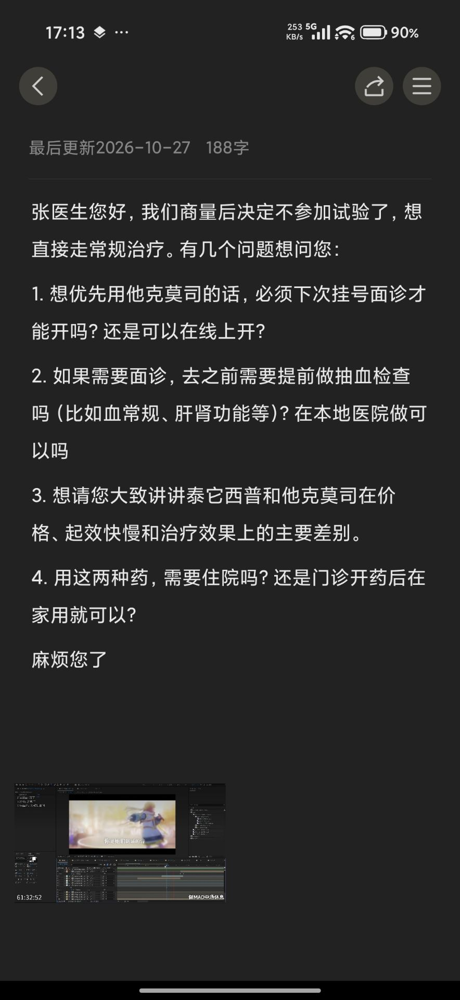
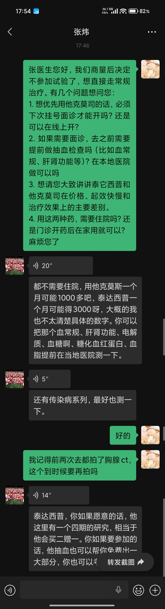

# 2026-10-28 张炜微信：不参加试验

这是微信屏幕上的文字，不是处方，也不是换药方案。语音原声不在库里。长段文字像语音识别结果，药名按各条屏幕上的写法保留，不改成标准名。不据此修改 [[当前用药]]。是否开药、用哪一种，等写有药名和毫克的回复或处方。

这份资料回答的问题：家里后来对张炜说了什么，屏幕上留下了哪些回复。10 月 26 日那次见 [[2026-10-26-张炜微信回复]]。

微信这张截图没有印日历。状态栏是 17:46 和 17:54，文件于 2026-10-28 18:04 放进收件箱，所以这篇日期写 2026-10-28。城市写太原，是因为 10 月 26 日的号在 [[2026-10-26-山医大一院挂号]]。截图本身没有印医院名。

## 提问草稿

另一张是备忘页，页眉写「最后更新 2026-10-27，188 字」。正文和下面发出去的绿气泡是同一组问题。页面最下方有一张与这次问诊无关的画面，不抄。

## 发给张炜的文字

> 张医生您好，我们商量后决定不参加试验了，想直接走常规治疗。有几个问题想问您：
> 1. 想优先用他克莫司的话，必须下次挂号面诊才能开吗？还是可以在线上开？
> 2. 如果需要面诊，去之前需要提前做抽血检查吗（比如血常规、肝肾功能等）？在本地医院做可以吗
> 3. 想请您大致讲讲泰它西普和他克莫司在价格、起效快慢和治疗效果上的主要差别。
> 4. 用这两种药，需要住院吗？还是门诊开药后在家用就可以？
> 麻烦您了

「不参加试验」是这则绿气泡里的话。这里的「试验」没有写名称。10 月 26 日屏幕上的临床试验也没有名称，两处先不并成同一个项目。

## 屏幕上的回复

一条 20 秒语音之后的文字。图上没有标明它就是该语音的转写：

> 都不需要住院，用他克莫斯一个月可能1000多吧，泰达西普一个月可能得3000呀，大概的我也不太清楚具体的数字。你可以把那个血常规、肝肾功能、电解质、血糖啊、糖化血红蛋白、血脂提前在当地医院测一下。

一条 5 秒语音之后的文字：

> 还有传染病系列，最好也测一下。

绿色气泡接着是：好的。

然后：

> 我记得前两次去都拍了胸腺ct，这个到时候要再拍吗

一条 14 秒语音之后的文字，下沿被截断，后面没拍到：

> 泰达西普，你如果愿意的话，他这里有一个四期的研究，相当于他会买二赠一。你如果要参加的话，他抽血也可以帮你免费出一大部分，你也可以

这一条没有写完。不把没拍到的部分补上。

患者绿气泡写的是「他克莫司」「泰它西普」。回复里写的是「他克莫斯」「泰达西普」。费用是「可能」「大概」，并写了不太清楚具体数字。没有毫克，没有一天几次，没有说现在就开始吃。线上能不能开、两种药的起效和效果差别、胸腺 CT 要不要再拍，可见文字里都没有回答。「都不需要住院」只覆盖住院这一句，没有写成「门诊开药后在家用就可以」。

「四期的研究」和前面「不参加试验」不是同一句。参加与否，这条截断文字不能代替决定。

## 原件

## 待核实

- 20 秒、5 秒、14 秒语音原件不在库里。
- 最后一条下半截没有拍到。四期研究的名称、药物规范名和书面说明都没有。
- 血常规、肝肾功能、电解质、血糖、糖化血红蛋白、血脂、传染病系列，只有屏幕上的这些词，没有化验单。
- 胸腺 CT 要不要再拍，这张截图没有回答。2016 年和 2019 年的胸部影像原件也不在库里。
- 仍没有写有毫克数的新处方。[[当前用药]] 不改。
