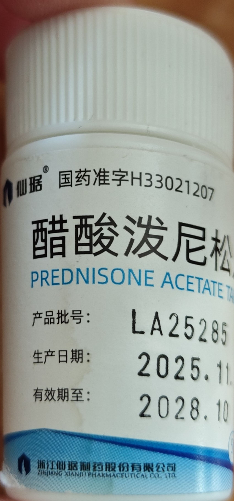
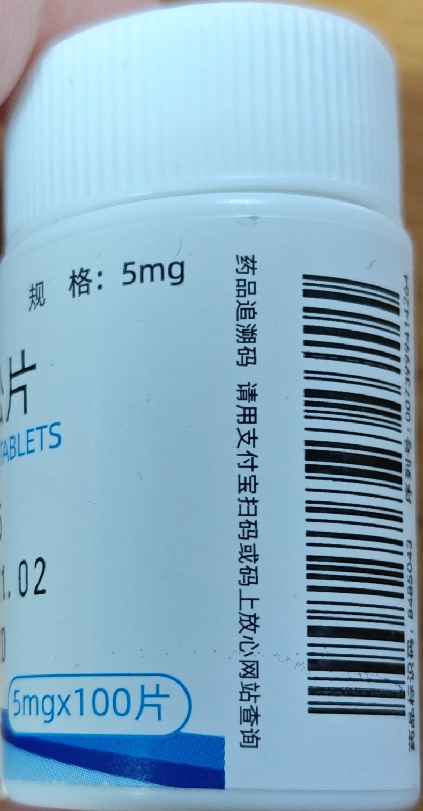
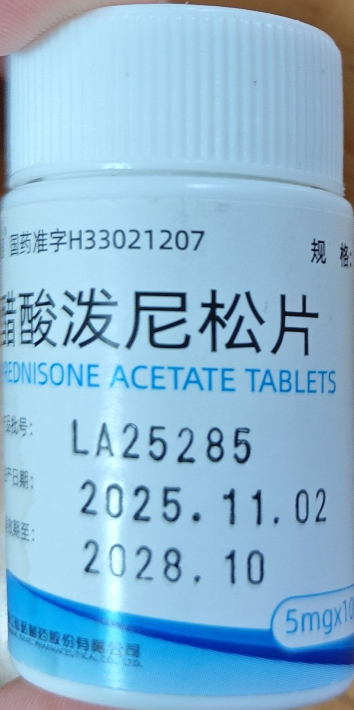
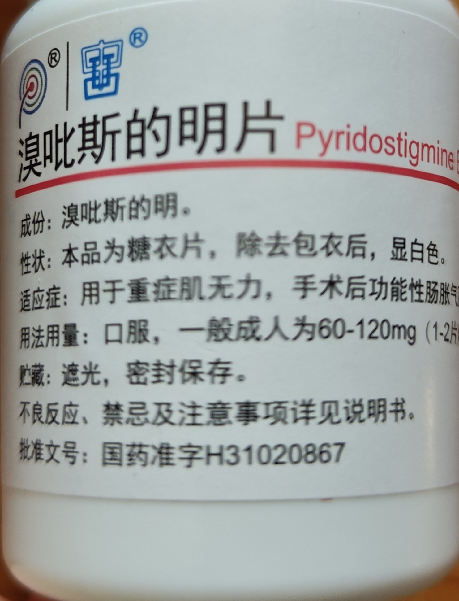
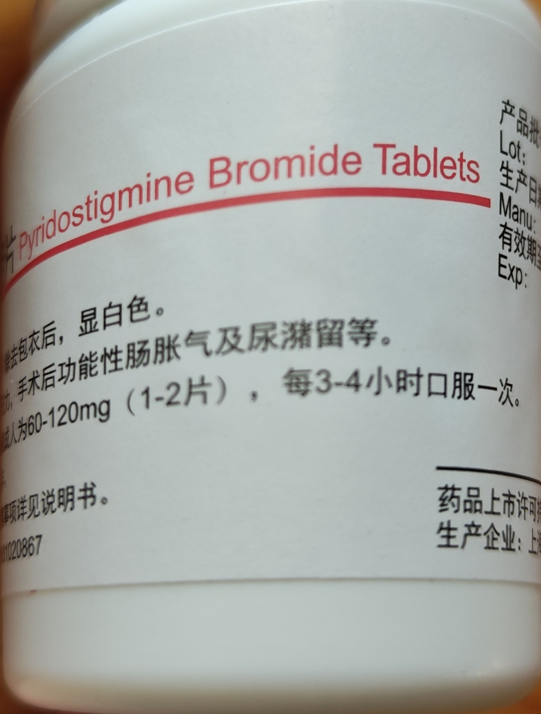
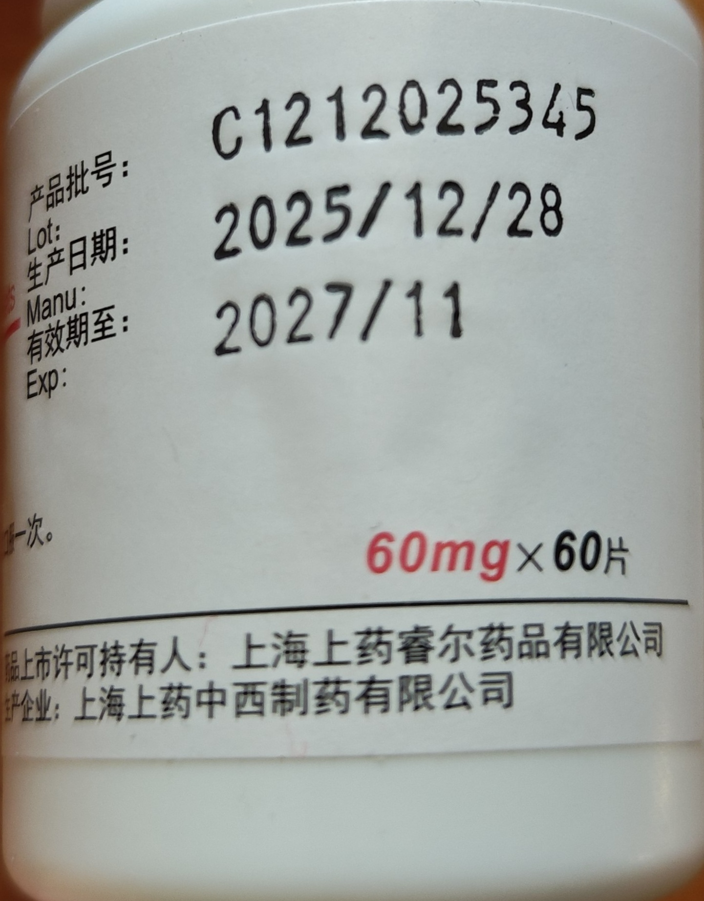
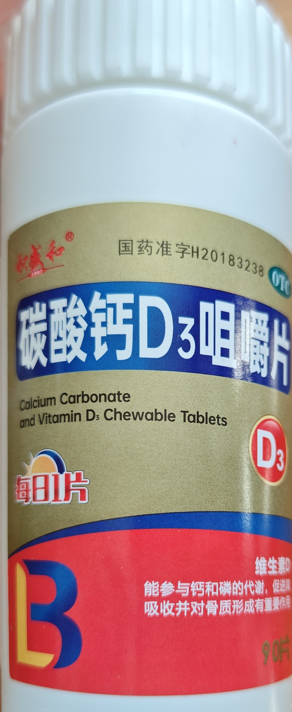
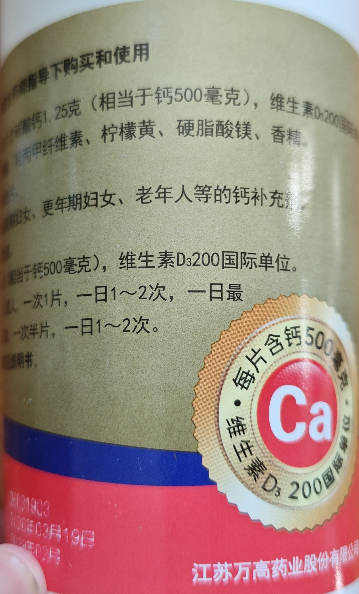
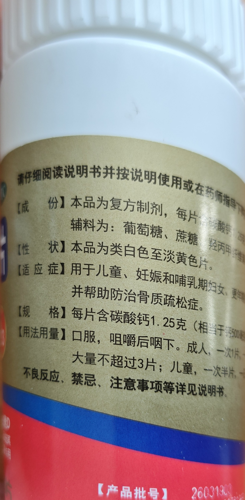

# 当前用药

这是家里写下的目前用法，加上 2026-10-28 的药瓶照片。不是处方，也不是用药建议。是否继续、是否减量，由主治医生决定。不要用 2016 年的出院剂量代替这里的片数。瓶签上的说明书用法也不是这次的服法。

这份资料回答的问题：现在每天在吃哪三瓶药、家里怎么分次，以及瓶签上能看清的规格。

## 2026-10-28 家里写的服法

原文：

> 醋酸泼尼松片：早晨空腹吃一天3片（15mg）
> 溴吡斯的明片：早中晚各一片
> 钙片：一片 晚上吃

「早晨空腹」和钙片「晚上吃」是这次新写的。15 mg 是家里写的一天合计，不是从泼尼松瓶签上读到的。

## 药瓶上能看清的字

醋酸泼尼松片：

- 仙琚。国药准字 H33021207。浙江仙琚制药股份有限公司。
- 规格：5 mg。瓶身另一面写 5 mg × 100 片。
- 产品批号 LA25285。生产日期 2025.11.02。有效期至拍到 2028.10，日子仍被裁掉。
- 家里写早晨空腹 3 片、合计 15 mg。3 片乘瓶签上的 5 mg，等于这个合计。合计仍是家里写的，不是瓶签上的一句医嘱。

溴吡斯的明片：

- 成份写溴吡斯的明。英文标写 Pyridostigmine Bromide Tablets。批准文号国药准字 H31020867。
- 规格写在另一面：60 mg × 60 片。药品上市许可持有人是上海上药睿尔药品有限公司，生产企业是上海上药中西制药有限公司。
- 产品批号 C1212025345。生产日期 2025/12/28。有效期至 2027/11，瓶签上没有写日子。
- 瓶签用法用量印的是：口服，一般成人为 60-120 mg（1-2 片），每 3-4 小时口服一次。这是说明书文字。家里这次写的是早、中、晚各 1 片。两句都保留，不合成一种服法。
- 2016-05-09 印刷医嘱是溴吡斯的明片 60 mg、一日 2 次。那是当时的出院医嘱，见 [[2016-05-出院医嘱]]。不把这次的早中晚各 1 片改成那一句，也不反过来改。

碳酸钙 D3 咀嚼片：

- 国药准字 H20183238，OTC，90 片。生产企业见瓶身下方：江苏万高药业股份有限公司。瓶签最上方的商品名这次未逐字核对。
- 规格：每片含碳酸钙 1.25 克（相当于钙 500 毫克），维生素 D3 200 国际单位。
- 瓶签上印有「每日 1 片」。用法用量印的是：口服，咀嚼后咽下。成人，一次 1 片，一日 1～2 次，一日最大量不超过 3 片。这是说明书文字。家里这次写的是晚上 1 片。

## 自述中的用法

2026-10-14 病情自述里的句子仍保留，原文在 [[2026-10-14-病情自述]]。

- 醋酸泼尼松：约 15 mg/天（3 片），自述维持多年。当时没写空腹。
- 溴吡斯的明片：早、中、晚各 1 片。自述没写每片毫克。
- 钙片：1 片/天。当时没写药名，也没写晚上。

## 原件

## 待核实

- 醋酸泼尼松有效期至只拍到 2028.10，日子仍未入镜。每片 5 mg 和批号、生产日期已经能看清。
- 碳酸钙 D3 咀嚼片瓶签上方的商品名未逐字核对。
- 2026-10-26 的微信没有写下新的毫克数，见 [[2026-10-26-张炜微信回复]]。这一页不按那段转写改服法。
- 2026-10-28 的微信仍没有毫克，见 [[2026-10-28-张炜微信-不参加试验]]。这一页也不按那段改服法。
