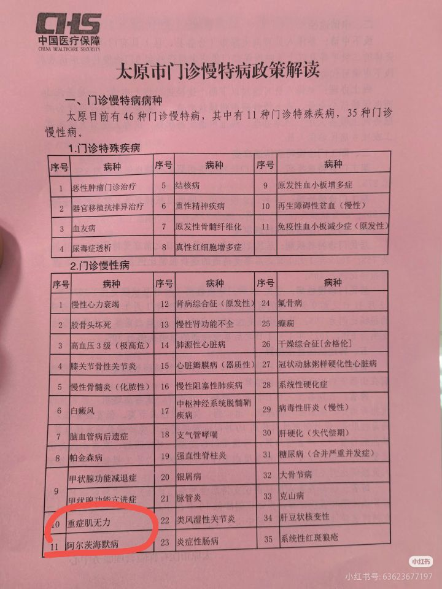

# 太原市门诊慢特病病种

这份资料回答的问题：这张太原市病种表把重症肌无力列在哪一类。

图题为「太原市门诊慢特病政策解读」，页眉为中国医疗保障标识。图中称太原当时有 46 种门诊慢特病，其中 11 种门诊特殊疾病、35 种门诊慢性病。重症肌无力出现在「2.门诊慢性病」序号 10，并被红圈标出。它不在同页的 11 种门诊特殊疾病列表里。

整表以原图为准，笔记不逐条重抄其余病种，避免抄错。报销比例、年度限额和认定材料这张图没有写。

页面带有小红书水印，小红书号 63623677197。发布日期未拍到。

## 原件

## 待核实

- 这份名单是否仍是太原现行版本。
- 太原对重症肌无力的报销比例、年度限额和认定医院。
- 图解未说明与就诊人参保地的关系。只有在参保地就是太原时，才拿它去对当地窗口。
