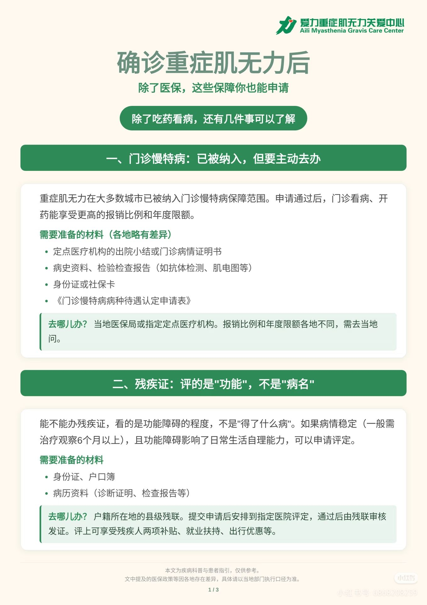

# 门诊慢特病与残疾证

这份资料回答的问题：确诊重症肌无力后，图解里提到可以了解哪些保障，以及要准备什么材料。

来源页面标题为「确诊重症肌无力后 / 除了医保，这些保障你也能申请」，机构名称为爱力重症肌无力关爱中心。页脚写明本文为疾病科普与患者指引，仅供参考；医保政策等各地存在差异，具体请以当地部门执行口径为准。本图是 1/3 页，第 2、3 页不在库中。

## 一、门诊慢特病

图解称重症肌无力在大多数城市已纳入门诊慢特病保障范围，申请通过后门诊看病、开药的报销比例和年度限额更高。各地材料有差异，图上列出的准备材料为：

- 定点医疗机构的出院小结或门诊病情证明书
- 病史资料、检验检查报告（如抗体检测、肌电图等）
- 身份证或社保卡
- 《门诊慢特病病种待遇认定申请表》

办理地点写的是当地医保局或指定定点医疗机构。报销比例和年度限额需到当地询问。

太原市病种名单里与本病相关的条目，见 [[太原市-门诊慢特病病种]]。

## 二、残疾证

图解称评定看的是功能障碍程度，不是病名。病情稳定（图中写一般需治疗观察 6 个月以上）且功能障碍影响日常生活自理能力时，可以申请评定。

图上列出的准备材料为：

- 身份证、户口簿
- 病历资料（诊断证明、检查报告等）

办理地点写的是户籍所在地的县级残联。提交申请后安排到指定医院评定，通过后由残联审核发证。图中举例的待遇包括残疾人两项补贴、就业扶持、出行优惠。

## 原件

## 待核实

- 第 2、3 页尚未入库。
- 图解没有写城市。能否办理、报销比例和限额以户籍地或参保地部门的口径为准。
